  

### Sobre mí

Soy Daniel, desarrollador backend junior. Construyo APIs y bases de datos con Java, Python y PostgreSQL, y me gusta dejar cada proyecto documentado y probado.

### Habilidades

**Lenguajes**

**Frameworks y librerías**

**Bases de datos y herramientas**

También trabajo con SQL, JPA, Flyway y Pytest.

### Proyectos

- [**XEON**](https://github.com/TuMinipeka/Xeon-agente-cotizaciones): agente de cotización para ferreterías por WhatsApp, con FastAPI y arquitectura hexagonal.
- [**Tool Rental Platform**](https://github.com/TuMinipeka/Tool-rental-platform): backend de alquiler de herramientas con Spring Boot, PostgreSQL y JWT.
- [**Formula1Simulator**](https://github.com/CondezPancake/Formula1Simulator): simulador de clasificación de Fórmula 1 con Java 17, JavaFX y MySQL.
- [**Motion Studio**](https://github.com/TuMinipeka/motion-studio-design): skill para que agentes de IA creen videos con HTML, Playwright y FFmpeg.
- [**Backend clínico con DDD**](https://github.com/TuMinipeka/SpringBootDataJPA-DDD): 52 bounded contexts con Spring Boot, JPA y Flyway.
- [**AtomManager**](https://github.com/CondezPancake/AtomManager): gestor de tareas de escritorio con Java 17, JavaFX y principios SOLID.

### Contacto

[LinkedIn](https://www.linkedin.com/in/daniel-santiago-mayorga-tellez-5bb0463a0/) · [Discord](https://discord.com/users/1445751258022416415)

<!-- Encabezado: python assets/generar_terminal.py (plantilla Typewriter Intro de beydemirfurkan/awesome-github-profile, MIT). Iconos: skillicons.dev (MIT). -->
