<!--
  Revisado: 2026-11-10.
  Vuelve a revisarlo cuando publiques un proyecto nuevo, cambie tu rol o empieces a buscar empleo.
  El encabezado se genera con: python assets/generar_encabezado.py
-->

<picture>
  <source media="(prefers-color-scheme: dark)" srcset="assets/encabezado-oscuro.svg">
  
</picture>

Construyo backends en los que las reglas de negocio viven en el dominio y no en el framework, y documento qué está probado y qué todavía no. Trabajo sobre todo con **Java 21 y Spring Boot**, **Python y FastAPI**, y **PostgreSQL con Flyway**.

Cuento mis proyectos como migraciones: cada uno se apoya en lo que aprendí en el anterior.

## Empieza por aquí

### [XEON, agente de cotización para ferreterías](https://github.com/TuMinipeka/Xeon-agente-cotizaciones)

Un agente que conversa por WhatsApp o por terminal, encuentra productos en un catálogo y prepara borradores de cotización. La regla del proyecto es que **la IA interpreta y el backend decide**: precios con `Decimal`, stock y descuentos salen de los casos de uso, nunca del modelo.

- **Qué hice:** soy el autor principal (261 de los 273 commits). Lo desarrollé orquestando agentes de IA con reglas escritas en `AGENTS.md` y una wiki compartida de decisiones.
- **Cómo comprobarlo:** cada push pasa por GitHub Actions con Ruff, mypy y Pytest. Hay 47 módulos de prueba y la suite bloquea cualquier llamada HTTP real.
- **Límite actual:** el catálogo de 2000 productos es sintético y los borradores viven en memoria.

### [Tool Rental Platform, alquiler de herramientas](https://github.com/TuMinipeka/Tool-rental-platform)

Backend en Java 21 y Spring Boot 3.5 con arquitectura hexagonal, 25 tablas en PostgreSQL y migraciones Flyway. Incluye reservas con políticas de cancelación, pagos simulados y sesiones con refresh tokens rotativos.

- **Qué hice:** proyecto en pareja con [@CondezPancake](https://github.com/CondezPancake). Mis 78 commits incluyen la estructura hexagonal, las sesiones rotativas, las políticas de alquiler, el checkout simulado y el despliegue del MVP.
- **Cómo comprobarlo:** una colección de Insomnia ejecutada con Inso CLI aprobó 41 peticiones y 61 comprobaciones contra PostgreSQL, y los recorridos de cliente, proveedor y administrador se verificaron con Playwright.
- **Límite actual:** se ejecuta y valida en local; todavía no tiene una demo pública.

### [Motion Studio, una skill de video para agentes de IA](https://github.com/TuMinipeka/motion-studio-design)

Una skill con licencia MIT que guía a un agente desde el guion hasta el MP4. Cada fotograma es una función pura del tiempo, `window.seek(t)`, que se renderiza con Playwright, la GPU elegida y FFmpeg.

- **Cómo comprobarlo:** se instala con `npx skills add TuMinipeka/motion-studio-design --skill motion-studio`, y el repositorio incluye un [video de ejemplo](https://github.com/TuMinipeka/motion-studio-design/tree/main/ejemplo).
- **Límite actual:** el render solo está validado en Windows 11 con una RTX 3050.

## Historial completo

La fecha es la de creación de cada repositorio.

| Versión | Proyecto | Qué aprendí a construir |
| :-- | :-- | :-- |
| V1, ene 2026 | [Sistema de préstamo de herramientas](https://github.com/TuMinipeka/Sistema-Prestamo-Herramientas) | CRUD, roles y registro de eventos en Python, con persistencia en JSON |
| V2, jun 2026 | [WildLens AI](https://github.com/TuMinipeka/fiftyone_pruebas) | Prototipo: FastAPI, React, YOLOv8 y un LLM para analizar fotos de fauna |
| V3, sep 2026 | [Plataforma SST/PESV](https://github.com/TuMinipeka/Plataforma_multi-tenant_de_gesti-n_SST-PESV) | Base de datos multi-tenant en PostgreSQL 16: 20 tablas en 4FN, vistas, procedimientos y triggers |
| V4, oct 2026 | [Backend clínico con Flyway](https://github.com/TuMinipeka/BackendMigraci-n_SpringBoot) | Un esquema de 52 tablas versionado con 52 migraciones |
| V5, oct 2026 | [Backend clínico con JPA y DDD](https://github.com/TuMinipeka/SpringBootDataJPA-DDD) | Las mismas 52 tablas como bounded contexts con dominio, casos de uso, API REST y JPA |
| V6, oct 2026 | [XEON](https://github.com/TuMinipeka/Xeon-agente-cotizaciones) | Un agente de IA con arquitectura hexagonal, CI y WhatsApp |
| V7, oct 2026 | [Tool Rental Platform](https://github.com/TuMinipeka/Tool-rental-platform) | Seguridad de sesiones, pagos simulados y pruebas de sistema |
| V8, oct 2026 | [Gestión operativa de Campuslands](https://github.com/TuMinipeka/soluciones-rocket) | Hackatón en un equipo de cinco; me encargué de la persistencia, el SEED, el inventario, la importación de datos y Docker Compose |
| V9, oct 2026 | [Motion Studio](https://github.com/TuMinipeka/motion-studio-design) | Render determinista de video y una skill publicada para agentes |

También he contribuido en repositorios de compañeros, como [Formula1Simulator](https://github.com/CondezPancake/Formula1Simulator) y [AcmeBank](https://github.com/DMntill4/ProyectoAcmebank_JavaScript_MayorgaDanielPanquebaDiego).

## Cómo trabajo

- **El dominio no conoce el framework.** En XEON el dominio no importa FastAPI ni HTTPX; en Tool Rental, dominio y aplicación no importan Spring ni Hibernate. Todo lo externo entra por un puerto.
- **El esquema se versiona.** Las bases de datos cambian con migraciones de Flyway, no con cambios a mano.
- **Cada README separa lo que funciona de lo que falta.** Mis proyectos tienen una sección de límites para que nadie tenga que adivinarlos.
- **Uso agentes de IA con reglas escritas.** Mis repositorios incluyen `AGENTS.md` con las convenciones que deben seguir, y su trabajo pasa por las mismas pruebas que cualquier otro cambio.

## Herramientas y dónde verlas

| Área | Herramientas | Dónde verlas |
| :-- | :-- | :-- |
| Backend Java | Java 21, Spring Boot 3, JPA/Hibernate, Flyway, Maven | Tool Rental, Backend clínico con JPA y DDD |
| Backend Python | FastAPI, Pydantic, Typer, Pytest, mypy, Ruff, uv | XEON |
| Datos | PostgreSQL, vistas, procedimientos, triggers, SQLAlchemy | Plataforma SST/PESV, XEON |
| Entrega | Docker Compose, GitHub Actions, Swagger/OpenAPI | Tool Rental, XEON |
| Frontend | React con Vite | Tool Rental, WildLens AI |
| Video | Playwright, FFmpeg, Three.js | Motion Studio |

## Contacto

Escríbeme por [LinkedIn](https://www.linkedin.com/in/daniel-santiago-mayorga-tellez-5bb0463a0/) o [Discord](https://discord.com/users/1445751258022416415). Si encuentras un error en alguno de mis proyectos, abre un issue en su repositorio.

<strong>In English</strong>

I'm Daniel, a junior backend developer working with Java 21 and Spring Boot, Python and FastAPI, and PostgreSQL with Flyway. I keep business rules in the domain layer, version every schema change, and document what is tested and what is not. Start with [XEON](https://github.com/TuMinipeka/Xeon-agente-cotizaciones), an AI quoting agent where the model interprets and the backend decides, or [Tool Rental Platform](https://github.com/TuMinipeka/Tool-rental-platform), a hexagonal Spring Boot backend checked with 41 API requests and 61 assertions. My project READMEs are written in Spanish.

