<h1>
<picture>
  <source media="(max-width: 600px) and (prefers-reduced-motion: reduce)" srcset="./assets/profile/miles-card-mobile-static.svg">
  <source media="(prefers-reduced-motion: reduce)" srcset="./assets/profile/miles-card-static.svg">
  <source media="(max-width: 600px)" srcset="./assets/profile/miles-card-mobile.svg">
  
</picture>
</h1>

Soy Daniel, **Junior Backend Developer** y Técnico Laboral en Desarrollo de Software. Construyo APIs y bases de datos con **Java, Spring Boot, Python, FastAPI y PostgreSQL**, y me gusta probar ideas nuevas hasta ver qué puedo crear con lo que aprendo.

Español nativo · Inglés B2 
[LinkedIn](https://www.linkedin.com/in/daniel-santiago-mayorga-tellez-5bb0463a0/) · [Correo](mailto:danielsantiagomayorga03@gmail.com) · [Discord](https://discord.com/users/1445751258022416415)

<picture>
  <source media="(prefers-color-scheme: dark)" srcset="./assets/profile/divider-noche.svg">
  
</picture>

## Proyectos

<picture>
  <source media="(max-width: 600px) and (prefers-color-scheme: dark)" srcset="./assets/profile/projects-noche-mobile.svg">
  <source media="(max-width: 600px)" srcset="./assets/profile/projects-papel-mobile.svg">
  <source media="(prefers-color-scheme: dark)" srcset="./assets/profile/projects-noche.svg">
  
</picture>

### [XEON · Cotizaciones asistidas por IA](https://github.com/Dvanielx03/Xeon-agente-cotizaciones)

Recibe solicitudes por WhatsApp o terminal, busca productos y prepara borradores de cotización. El modelo interpreta la conversación; el backend calcula precios, descuentos y disponibilidad con `Decimal`, dentro de una arquitectura hexagonal con FastAPI.

**Compruébalo:** [arquitectura](https://github.com/Dvanielx03/Xeon-agente-cotizaciones/blob/develop/docs/ARCHITECTURE.md) y [CI aprobado con Ruff, mypy y Pytest](https://github.com/Dvanielx03/Xeon-agente-cotizaciones/actions/runs/40413280218). 
**Estado:** prototipo con catálogo sintético. El borrador no reserva inventario ni equivale a una cotización aprobada.

### [Tool Rental Platform · Alquiler de herramientas](https://github.com/Dvanielx03/Tool-rental-platform)

Proyecto en equipo con **Java 21, Spring Boot y PostgreSQL**: catálogo, reservas, pagos académicos y operaciones de cliente, proveedor y administrador. Mi aporte fue la integración del MVP, Docker Compose y la verificación de recorridos y persistencia.

**Compruébalo:** [responsabilidades e integración](https://github.com/Dvanielx03/Tool-rental-platform/blob/develop/docs/mvp.md) y [persistencia por roles](https://github.com/Dvanielx03/Tool-rental-platform/blob/develop/docs/provider-persistence.md). 
**Estado:** validado en local; demo pública pendiente y pagos simulados.

### [Motion Studio · Video programable para agentes](https://github.com/Dvanielx03/motion-studio-design)

Skill abierta con licencia MIT para crear video con HTML y JavaScript, del guion al MP4. Cada fotograma depende de `window.seek(t)` y se renderiza con **Playwright, Chrome y FFmpeg**.

**Compruébalo:** [video de ejemplo](https://github.com/Dvanielx03/motion-studio-design/tree/main/ejemplo) y [pruebas 2.5D](https://github.com/Dvanielx03/motion-studio-design/blob/main/docs/analysis/2026-11-06-make-short-integrado.md). 
**Estado:** render validado principalmente en Windows 11 con RTX 3050.

## Tecnologías

<!-- tecnologias:inicio (generado por assets/profile/stack.py) -->
Abre cada Tierra y toca una pegatina: verás los proyectos donde uso esa tecnología, con la prueba en el código. El número indica en cuántos proyectos públicos aparece.

<picture>
  <source media="(prefers-color-scheme: dark)" srcset="./assets/profile/stack/cajon-backend-noche.svg">
  
</picture>

 

<a href="./docs/stack/java.md"><picture><source media="(prefers-color-scheme: dark)" srcset="./assets/profile/stack/java-noche.svg"></picture></a> <a href="./docs/stack/spring-boot.md"><picture><source media="(prefers-color-scheme: dark)" srcset="./assets/profile/stack/spring-boot-noche.svg"></picture></a> <a href="./docs/stack/hibernate.md"><picture><source media="(prefers-color-scheme: dark)" srcset="./assets/profile/stack/hibernate-noche.svg"></picture></a> <a href="./docs/stack/maven.md"><picture><source media="(prefers-color-scheme: dark)" srcset="./assets/profile/stack/maven-noche.svg"></picture></a> <a href="./docs/stack/python.md"><picture><source media="(prefers-color-scheme: dark)" srcset="./assets/profile/stack/python-noche.svg"></picture></a> <a href="./docs/stack/fastapi.md"><picture><source media="(prefers-color-scheme: dark)" srcset="./assets/profile/stack/fastapi-noche.svg"></picture></a>

<picture>
  <source media="(prefers-color-scheme: dark)" srcset="./assets/profile/stack/cajon-frontend-noche.svg">
  
</picture>

 

<a href="./docs/stack/html.md"><picture><source media="(prefers-color-scheme: dark)" srcset="./assets/profile/stack/html-noche.svg"></picture></a> <a href="./docs/stack/css.md"><picture><source media="(prefers-color-scheme: dark)" srcset="./assets/profile/stack/css-noche.svg"></picture></a> <a href="./docs/stack/javascript.md"><picture><source media="(prefers-color-scheme: dark)" srcset="./assets/profile/stack/javascript-noche.svg"></picture></a> <a href="./docs/stack/typescript.md"><picture><source media="(prefers-color-scheme: dark)" srcset="./assets/profile/stack/typescript-noche.svg"></picture></a> <a href="./docs/stack/react.md"><picture><source media="(prefers-color-scheme: dark)" srcset="./assets/profile/stack/react-noche.svg"></picture></a> <a href="./docs/stack/tailwind.md"><picture><source media="(prefers-color-scheme: dark)" srcset="./assets/profile/stack/tailwind-noche.svg"></picture></a> <a href="./docs/stack/vite.md"><picture><source media="(prefers-color-scheme: dark)" srcset="./assets/profile/stack/vite-noche.svg"></picture></a>

<picture>
  <source media="(prefers-color-scheme: dark)" srcset="./assets/profile/stack/cajon-datos-noche.svg">
  
</picture>

 

<a href="./docs/stack/postgresql.md"><picture><source media="(prefers-color-scheme: dark)" srcset="./assets/profile/stack/postgresql-noche.svg"></picture></a> <a href="./docs/stack/flyway.md"><picture><source media="(prefers-color-scheme: dark)" srcset="./assets/profile/stack/flyway-noche.svg"></picture></a> <a href="./docs/stack/sqlalchemy.md"><picture><source media="(prefers-color-scheme: dark)" srcset="./assets/profile/stack/sqlalchemy-noche.svg"></picture></a> <a href="./docs/stack/sqlite.md"><picture><source media="(prefers-color-scheme: dark)" srcset="./assets/profile/stack/sqlite-noche.svg"></picture></a> <a href="./docs/stack/supabase.md"><picture><source media="(prefers-color-scheme: dark)" srcset="./assets/profile/stack/supabase-noche.svg"></picture></a>

<picture>
  <source media="(prefers-color-scheme: dark)" srcset="./assets/profile/stack/cajon-herramientas-noche.svg">
  
</picture>

 

<a href="./docs/stack/git.md"><picture><source media="(prefers-color-scheme: dark)" srcset="./assets/profile/stack/git-noche.svg"></picture></a> <a href="./docs/stack/github.md"><picture><source media="(prefers-color-scheme: dark)" srcset="./assets/profile/stack/github-noche.svg"></picture></a> <a href="./docs/stack/vscode.md"><picture><source media="(prefers-color-scheme: dark)" srcset="./assets/profile/stack/vscode-noche.svg"></picture></a> <a href="./docs/stack/docker.md"><picture><source media="(prefers-color-scheme: dark)" srcset="./assets/profile/stack/docker-noche.svg"></picture></a> <a href="./docs/stack/github-actions.md"><picture><source media="(prefers-color-scheme: dark)" srcset="./assets/profile/stack/github-actions-noche.svg"></picture></a> <a href="./docs/stack/pytest.md"><picture><source media="(prefers-color-scheme: dark)" srcset="./assets/profile/stack/pytest-noche.svg"></picture></a> <a href="./docs/stack/langchain.md"><picture><source media="(prefers-color-scheme: dark)" srcset="./assets/profile/stack/langchain-noche.svg"></picture></a> <a href="./docs/stack/streamlit.md"><picture><source media="(prefers-color-scheme: dark)" srcset="./assets/profile/stack/streamlit-noche.svg"></picture></a>

<!-- tecnologias:fin -->

<picture>
  <source media="(prefers-color-scheme: dark)" srcset="./assets/profile/divider-noche.svg">
  
</picture>

## Colaboración y método

**[Campus Control](https://github.com/Dvanielx03/soluciones-rocket)**: hackatón de cinco integrantes. Me encargué de la persistencia, los datos iniciales, el inventario, la importación y Docker Compose. [Responsabilidades del equipo](https://github.com/Dvanielx03/soluciones-rocket/blob/main/docs/teamResponsibilities.md) · [PR integrado](https://github.com/Dvanielx03/soluciones-rocket/pull/3).

**[Formula1Simulator](https://github.com/CondezJuan8/Formula1Simulator)**: aporté una refactorización a arquitectura hexagonal y correcciones del menú JavaFX. [PR integrado](https://github.com/CondezJuan8/Formula1Simulator/pull/4).

**Cómo trabajo:**

- Separo las reglas del negocio de los frameworks y servicios externos.
- Versiono los cambios de base de datos con migraciones.
- Documento el alcance, las pruebas disponibles y lo que queda pendiente.
- Trabajo con agentes de IA mediante instrucciones escritas y revisión de cambios.

<a href="mailto:danielsantiagomayorga03@gmail.com">
<picture>
  <source media="(max-width: 600px) and (prefers-color-scheme: dark)" srcset="./assets/profile/contact-noche-mobile.svg">
  <source media="(max-width: 600px)" srcset="./assets/profile/contact-papel-mobile.svg">
  <source media="(prefers-color-scheme: dark)" srcset="./assets/profile/contact-noche.svg">
  
</picture>
</a>

Escríbeme a [danielsantiagomayorga03@gmail.com](mailto:danielsantiagomayorga03@gmail.com) o por [LinkedIn](https://www.linkedin.com/in/daniel-santiago-mayorga-tellez-5bb0463a0/).

<!-- Responsable: Daniel Santiago Mayorga. Revisión: 2026-11-11.
Dirección visual «Fuera de registro»: docs/PROFILE-DESIGN.md. Generar los SVG: python assets/profile/generate.py
Portafolio web y hoja de vida: añadir sus enlaces junto al contacto cuando estén publicados.
-->
