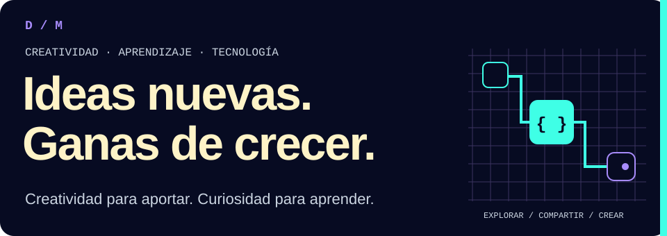
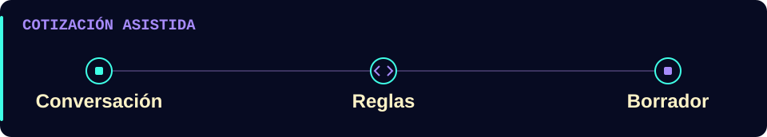
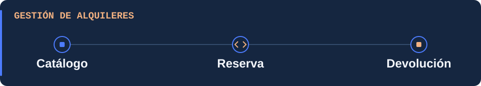
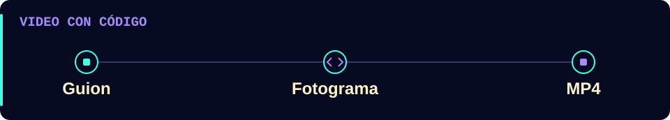
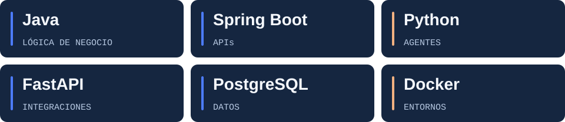
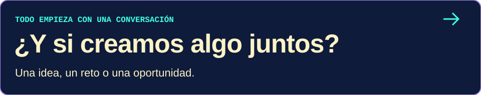

# Daniel Santiago Mayorga

**Junior Backend Developer · Java, Python y SQL**

Desarrollo APIs, bases de datos e integraciones para procesos como cotizaciones, alquileres e inventarios. Trabajo con **Spring Boot**, **FastAPI** y datos relacionales, con reglas de negocio, pruebas y documentación.

<picture>
  <source media="(max-width: 600px)" srcset="./assets/profile/hero-mobile.svg">
  
</picture>

Cuéntame qué proceso quieres resolver y qué necesitas conectar. [También puedes encontrarme en LinkedIn](https://www.linkedin.com/in/daniel-santiago-mayorga-tellez-5bb0463a0/).

[Proyectos](#proyectos) · [Tecnologías](#tecnologias) · [Colaboración](#colaboracion) · [Contacto](#contacto)

<picture></picture>

## <picture></picture> Proyectos destacados

**Empieza por XEON** para ver cómo separo la conversación con IA de las decisiones del negocio. Tool Rental muestra un flujo de alquileres; Motion Studio, una herramienta propia para crear video con código.

### [XEON · Cotizaciones asistidas por IA](https://github.com/Dvanielx03/Xeon-agente-cotizaciones)

<picture>
  <source media="(max-width: 600px)" srcset="./assets/profile/xeon-mobile.svg">
  
</picture>

Recibe solicitudes por WhatsApp o terminal, busca productos y prepara borradores de cotización. El backend calcula precios, descuentos y disponibilidad; el modelo interpreta la conversación.

- **Trabajo técnico:** arquitectura hexagonal, FastAPI, interfaz de terminal y adaptadores de mensajería e IA. Los importes se calculan con `Decimal`.
- **Compruébalo:** [arquitectura](https://github.com/Dvanielx03/Xeon-agente-cotizaciones/blob/develop/docs/ARCHITECTURE.md) y [CI aprobado con Ruff, mypy y Pytest](https://github.com/Dvanielx03/Xeon-agente-cotizaciones/actions/runs/40413280218).
- **Estado:** prototipo con catálogo sintético por defecto. El borrador no reserva inventario ni equivale a una cotización aprobada.

### [Tool Rental Platform · Alquiler de herramientas](https://github.com/Dvanielx03/Tool-rental-platform)

<picture>
  <source media="(max-width: 600px)" srcset="./assets/profile/rental-mobile.svg">
  
</picture>

Proyecto en equipo con **Java 21, Spring Boot y PostgreSQL** para catálogo, reservas, pagos académicos y operaciones de cliente, proveedor y administrador.

- **Mi aporte documentado:** integración del MVP, Docker Compose y verificación de recorridos y persistencia dentro de una arquitectura hexagonal compartida.
- **Compruébalo:** [responsabilidades e integración](https://github.com/Dvanielx03/Tool-rental-platform/blob/develop/docs/mvp.md) y [persistencia por roles](https://github.com/Dvanielx03/Tool-rental-platform/blob/develop/docs/provider-persistence.md).
- **Estado:** validación local documentada; demo pública pendiente y pagos simulados.

### [Motion Studio · Video programable para agentes](https://github.com/Dvanielx03/motion-studio-design)

<picture>
  <source media="(max-width: 600px)" srcset="./assets/profile/motion-mobile.svg">
  
</picture>

Skill abierta con licencia MIT para crear video con HTML y JavaScript, desde el guion hasta el MP4. Cada fotograma depende de `window.seek(t)` y se renderiza con **Playwright, Chrome y FFmpeg**.

- **Trabajo técnico:** composición reproducible, render por segmentos y revisión audiovisual.
- **Compruébalo:** [video de ejemplo](https://github.com/Dvanielx03/motion-studio-design/tree/main/ejemplo), [pruebas 2.5D](https://github.com/Dvanielx03/motion-studio-design/blob/main/docs/analysis/2026-11-06-make-short-integrado.md) y [actualización del 6 de noviembre de 2026](https://github.com/Dvanielx03/motion-studio-design/commit/1ebed6c5fef0cc8c5dfdd47b1bdc7bce92c68b42).
- **Estado:** render validado principalmente en Windows 11 con RTX 3050. El acabado requiere revisión visual y escucha.

<picture></picture>

## <picture></picture> Tecnologías aplicadas

<picture>
  <source media="(max-width: 600px)" srcset="./assets/profile/technologies-mobile.svg">
  
</picture>

- **Backend Java:** Java, Spring Boot, JPA/Hibernate y Maven en [Tool Rental](https://github.com/Dvanielx03/Tool-rental-platform) y el [backend clínico](https://github.com/Dvanielx03/SpringBootDataJPA-DDD).
- **Backend Python:** Python, FastAPI, Pydantic y Typer en [XEON](https://github.com/Dvanielx03/Xeon-agente-cotizaciones).
- **Datos:** PostgreSQL y Flyway en Tool Rental y el backend clínico; SQLite y SQLAlchemy en [Campus Control](https://github.com/Dvanielx03/soluciones-rocket); SQL y PL/pgSQL en la [plataforma multiempresa de seguridad laboral y vial](https://github.com/Dvanielx03/Plataforma_multi-tenant_de_gesti-n_SST-PESV).
- **Calidad y entrega:** Pytest, Ruff, mypy y GitHub Actions en XEON; Docker Compose en Tool Rental y Campus Control.
- **Interfaces y video:** JavaScript y React en Tool Rental y [WildLens AI](https://github.com/Dvanielx03/fiftyone_pruebas); JavaFX en Formula1Simulator; HTML, JavaScript, Playwright y FFmpeg en Motion Studio.

<picture></picture>

## <picture></picture> Colaboración y aportes

**[Campus Control](https://github.com/Dvanielx03/soluciones-rocket)** 
Hackatón de cinco integrantes. Mi área abarcó persistencia, datos iniciales, inventario, importación y Docker Compose. [Responsabilidades del equipo](https://github.com/Dvanielx03/soluciones-rocket/blob/main/docs/teamResponsibilities.md) · [PR integrado: disponibilidad y detalles de reservas](https://github.com/Dvanielx03/soluciones-rocket/pull/3).

**[Formula1Simulator](https://github.com/CondezJuan8/Formula1Simulator)** 
Aporté una refactorización a arquitectura hexagonal y correcciones del menú JavaFX. [Ver el PR integrado](https://github.com/CondezJuan8/Formula1Simulator/pull/4).

<picture></picture>

## <picture></picture> Formación

**Técnico Laboral en Desarrollo de Software.**

<picture></picture>

## <picture></picture> Idiomas

**Español:** nativo. 
**Inglés:** B2.

<picture></picture>

## <picture></picture> Cómo trabajo

- Separo las reglas del negocio de los frameworks y servicios externos.
- Versiono los cambios de base de datos con migraciones.
- Documento el alcance, las pruebas disponibles y lo que queda pendiente.
- Trabajo con agentes de IA mediante instrucciones escritas y revisión de cambios.

<picture></picture>

## <picture></picture> Contacto

<a href="mailto:danielsantiagomayorga03@gmail.com">
<picture>
  <source media="(max-width: 600px)" srcset="./assets/profile/contact-mobile.svg">
  
</picture>
</a>

Escríbeme con el problema, el resultado que buscas y las herramientas que ya utilizas.

**[danielsantiagomayorga03@gmail.com](mailto:danielsantiagomayorga03@gmail.com)** 
[LinkedIn](https://www.linkedin.com/in/daniel-santiago-mayorga-tellez-5bb0463a0/) · [Discord](https://discord.com/users/1445751258022416415)

Para preguntas técnicas sobre un proyecto, abre un issue en su repositorio.

<!-- Responsable: Daniel Santiago Mayorga. Revisión: 2026-11-11.
Revisar al publicar un proyecto o versión importante, cambiar de rol o iniciar una búsqueda laboral.
Formación, idiomas y contactos confirmados por el titular. Experiencia laboral omitida por petición.
Diseño y generación: docs/PROFILE-DESIGN.md y assets/profile/generate.py.
-->
