**TIERRA-04 · Herramientas e IA**

## Dónde la uso

Cada sello abre el archivo del proyecto donde se declara o se usa.

| Proyecto | Prueba |
| :-- | :-- |
| [XEON](https://github.com/Dvanielx03/Xeon-agente-cotizaciones) |  [`compose.yaml`](https://github.com/Dvanielx03/Xeon-agente-cotizaciones/blob/develop/compose.yaml) |
| [Tool Rental Platform](https://github.com/Dvanielx03/Tool-rental-platform) |  [`compose.yml`](https://github.com/Dvanielx03/Tool-rental-platform/blob/develop/compose.yml) |
| [Campus Control](https://github.com/Dvanielx03/soluciones-rocket) |  [`compose.yaml`](https://github.com/Dvanielx03/soluciones-rocket/blob/main/compose.yaml) |
| [WildLens AI](https://github.com/Dvanielx03/fiftyone_pruebas) |  [`docker-compose.yml`](https://github.com/Dvanielx03/fiftyone_pruebas/blob/main/docker-compose.yml) |
| [Plataforma SST/PESV](https://github.com/Dvanielx03/Plataforma_multi-tenant_de_gesti-n_SST-PESV) |  [`docker-compose.yml`](https://github.com/Dvanielx03/Plataforma_multi-tenant_de_gesti-n_SST-PESV/blob/main/docker-compose.yml) |

[Volver al perfil](https://github.com/Dvanielx03)

<!-- Generado por assets/profile/stack.py. Edita los datos allí, no este archivo. -->
