**TIERRA-01 · Backend**

## Dónde la uso

Cada sello abre el archivo del proyecto donde se declara o se usa.

| Proyecto | Prueba |
| :-- | :-- |
| [XEON](https://github.com/Dvanielx03/Xeon-agente-cotizaciones) |  [`pyproject.toml`](https://github.com/Dvanielx03/Xeon-agente-cotizaciones/blob/develop/pyproject.toml) |
| [Campus Control](https://github.com/Dvanielx03/soluciones-rocket) |  [`backend/requirements.txt`](https://github.com/Dvanielx03/soluciones-rocket/blob/main/backend/requirements.txt) |
| [WildLens AI](https://github.com/Dvanielx03/fiftyone_pruebas) |  [`backend/requirements.txt`](https://github.com/Dvanielx03/fiftyone_pruebas/blob/main/backend/requirements.txt) |

[Volver al perfil](https://github.com/Dvanielx03)

<!-- Generado por assets/profile/stack.py. Edita los datos allí, no este archivo. -->
