**TIERRA-04 · Herramientas e IA**

## Dónde la uso

Cada sello abre el archivo del proyecto donde se declara o se usa.

| Proyecto | Prueba |
| :-- | :-- |
| [XEON](https://github.com/Dvanielx03/Xeon-agente-cotizaciones) |  [`.github/workflows/ci.yml`](https://github.com/Dvanielx03/Xeon-agente-cotizaciones/blob/develop/.github/workflows/ci.yml) |
| [Campus Control](https://github.com/Dvanielx03/soluciones-rocket) |  [`.github/workflows/commit-convention.yml`](https://github.com/Dvanielx03/soluciones-rocket/blob/main/.github/workflows/commit-convention.yml) |

[Volver al perfil](https://github.com/Dvanielx03)

<!-- Generado por assets/profile/stack.py. Edita los datos allí, no este archivo. -->
