**TIERRA-02 · Frontend**

## Dónde la uso

Cada sello abre el archivo del proyecto donde se declara o se usa.

| Proyecto | Prueba |
| :-- | :-- |
| [Tool Rental Platform](https://github.com/Dvanielx03/Tool-rental-platform) |  [`frontend/src/main.jsx`](https://github.com/Dvanielx03/Tool-rental-platform/blob/develop/frontend/src/main.jsx) |
| [Campus Control](https://github.com/Dvanielx03/soluciones-rocket) |  [`frontend/src/main.jsx`](https://github.com/Dvanielx03/soluciones-rocket/blob/main/frontend/src/main.jsx) |
| [WildLens AI](https://github.com/Dvanielx03/fiftyone_pruebas) |  [`frontend/src/main.jsx`](https://github.com/Dvanielx03/fiftyone_pruebas/blob/main/frontend/src/main.jsx) |
| [Motion Studio](https://github.com/Dvanielx03/motion-studio-design) |  [`motion-studio/assets/plantilla/kit/camara.js`](https://github.com/Dvanielx03/motion-studio-design/blob/main/motion-studio/assets/plantilla/kit/camara.js) |

[Volver al perfil](https://github.com/Dvanielx03)

<!-- Generado por assets/profile/stack.py. Edita los datos allí, no este archivo. -->
