**TIERRA-03 · Datos**

## Dónde la uso

Cada sello abre el archivo del proyecto donde se declara o se usa.

| Proyecto | Prueba |
| :-- | :-- |
| [Tool Rental Platform](https://github.com/Dvanielx03/Tool-rental-platform) |  [`infrastructure/pom.xml`](https://github.com/Dvanielx03/Tool-rental-platform/blob/develop/infrastructure/pom.xml) |
| [Backend clínico con JPA y DDD](https://github.com/Dvanielx03/SpringBootDataJPA-DDD) |  [`infrastructure/pom.xml`](https://github.com/Dvanielx03/SpringBootDataJPA-DDD/blob/main/infrastructure/pom.xml) |
| [Plataforma SST/PESV](https://github.com/Dvanielx03/Plataforma_multi-tenant_de_gesti-n_SST-PESV) |  [`sql/01_schema.sql`](https://github.com/Dvanielx03/Plataforma_multi-tenant_de_gesti-n_SST-PESV/blob/main/sql/01_schema.sql) |
| [XEON](https://github.com/Dvanielx03/Xeon-agente-cotizaciones) |  [`pyproject.toml`](https://github.com/Dvanielx03/Xeon-agente-cotizaciones/blob/develop/pyproject.toml) |

[Volver al perfil](https://github.com/Dvanielx03)

<!-- Generado por assets/profile/stack.py. Edita los datos allí, no este archivo. -->
