**TIERRA-01 · Backend**

## Dónde la uso

Cada sello abre el archivo del proyecto donde se declara o se usa.

| Proyecto | Prueba |
| :-- | :-- |
| [Tool Rental Platform](https://github.com/Dvanielx03/Tool-rental-platform) |  [`pom.xml`](https://github.com/Dvanielx03/Tool-rental-platform/blob/develop/pom.xml) |
| [Backend clínico con JPA y DDD](https://github.com/Dvanielx03/SpringBootDataJPA-DDD) |  [`pom.xml`](https://github.com/Dvanielx03/SpringBootDataJPA-DDD/blob/main/pom.xml) |
| [Backend clínico con Flyway](https://github.com/Dvanielx03/BackendMigraci-n_SpringBoot) |  [`pom.xml`](https://github.com/Dvanielx03/BackendMigraci-n_SpringBoot/blob/main/pom.xml) |

[Volver al perfil](https://github.com/Dvanielx03)

<!-- Generado por assets/profile/stack.py. Edita los datos allí, no este archivo. -->
