**TIERRA-03 · Datos**

## Dónde la uso

Cada sello abre el archivo del proyecto donde se declara o se usa.

| Proyecto | Prueba |
| :-- | :-- |
| [Campus Control](https://github.com/Dvanielx03/soluciones-rocket) |  [`backend/app/core/config.py`](https://github.com/Dvanielx03/soluciones-rocket/blob/main/backend/app/core/config.py) |

[Volver al perfil](https://github.com/Dvanielx03)

<!-- Generado por assets/profile/stack.py. Edita los datos allí, no este archivo. -->
