**TIERRA-02 · Frontend**

## Dónde la uso

Cada sello abre el archivo del proyecto donde se declara o se usa.

| Proyecto | Prueba |
| :-- | :-- |
| [Campus Control](https://github.com/Dvanielx03/soluciones-rocket) |  [`frontend/package.json`](https://github.com/Dvanielx03/soluciones-rocket/blob/main/frontend/package.json) |

> **Nota:** también la uso en un proyecto privado (deportivo-langchain), cuyo código no es público.

[Volver al perfil](https://github.com/Dvanielx03)

<!-- Generado por assets/profile/stack.py. Edita los datos allí, no este archivo. -->
