**TIERRA-04 · Herramientas e IA**

## Dónde la uso

Cada sello abre el archivo del proyecto donde se declara o se usa.

| Proyecto | Prueba |
| :-- | :-- |
| [XEON](https://github.com/Dvanielx03/Xeon-agente-cotizaciones) |  [`.vscode/settings.json`](https://github.com/Dvanielx03/Xeon-agente-cotizaciones/blob/develop/.vscode/settings.json) |
| [Tool Rental Platform](https://github.com/Dvanielx03/Tool-rental-platform) |  [`.vscode/settings.json`](https://github.com/Dvanielx03/Tool-rental-platform/blob/develop/.vscode/settings.json) |
| [Backend clínico con JPA y DDD](https://github.com/Dvanielx03/SpringBootDataJPA-DDD) |  [`.vscode/settings.json`](https://github.com/Dvanielx03/SpringBootDataJPA-DDD/blob/main/.vscode/settings.json) |
| [Motion Studio](https://github.com/Dvanielx03/motion-studio-design) |  [`.vscode/settings.json`](https://github.com/Dvanielx03/motion-studio-design/blob/main/.vscode/settings.json) |

[Volver al perfil](https://github.com/Dvanielx03)

<!-- Generado por assets/profile/stack.py. Edita los datos allí, no este archivo. -->
